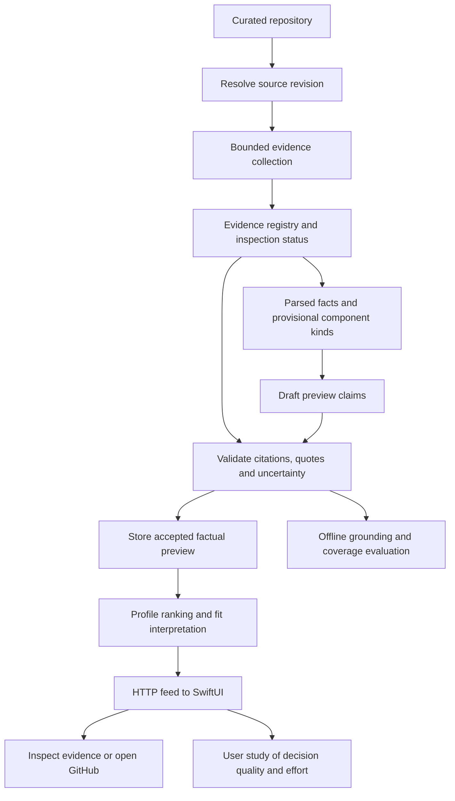

# GitDiagram architecture study and implications for GitTok

Date: October 30, 2026. Status: research findings and recommendations; no
architecture adoption or implementation is implied.

GitDiagram snapshot: `7876ab0ca8b5ee46e836235e23c4886d5cdb79ae`
(commit timestamp October 30, 2026). GitTok baseline:
`3bf15746e053a391e95d7752c9c97684187bb774`.

## Scope and method

Declan requested a swarm of agents to learn from GitDiagram's architecture while
recognizing that GitTok serves a different decision. Three agents independently
inspected (1) ingestion and evidence selection, (2) generation, grounding and
evaluation, and (3) runtime, media and feed behavior. The coordinating agent
cross-checked the principal request flow, validation/citation logic, and transfer
recommendations against GitTok's current packages and contract.

This was static inspection of implementations and tests in a shallow source
clone. No third-party dependencies were installed, project scripts or tests
executed, model requests made, or live deployment configuration verified. Test
citations show coverage intent, not a test run performed during this study.
GitTok's application code and issue statuses were unchanged.

The earlier Claude memory served as a lead rather than current proof. In
particular, the current default generation supports a single-pass structured
response; a two-stage explanation/graph path remains for other configurations.
An offline blind judge exists, but is not a production semantic acceptance gate.

## What the architecture actually does

GitDiagram's main application is Next.js/React/TypeScript, deployed through
Cloudflare Workers with R2 storage and Redis coordination. Worker boundaries
reflect routing, caching and execution needs; they do not establish that GitTok
needs separately deployed domain services. Media rendering uses Chromium/ffmpeg
containers. The source is MIT-licensed; this study describes patterns rather
than copying implementation into GitTok.

The diagram path is:

1. Admit and authenticate the request; arrange quota, cancellation and audit state.
2. Fetch repository metadata, tree and README.
3. Rank source candidates and fetch a bounded seed set.
4. Resolve source references, perform a bounded follow-up read, and choose excerpts.
5. Build a source index recording excerpt/read/not-read status.
6. Ask a model for an explanation and typed graph, or use the alternate two-stage path.
7. Validate structure and paths; repair optional links or retry structural failures.
8. Enforce citation eligibility and compile deterministic Mermaid.
9. Persist the accepted artifact and terminal audit state; serve it on later visits.

Sources: [request flow](https://github.com/ahmedkhaleel2004/gitdiagram/blob/7876ab0ca8b5ee46e836235e23c4886d5cdb79ae/src/app/api/generate/stream/route.ts#L126-L205),
[model mode selection](https://github.com/ahmedkhaleel2004/gitdiagram/blob/7876ab0ca8b5ee46e836235e23c4886d5cdb79ae/src/server/generate/model-config.ts#L63-L72),
[generation and validation handoff](https://github.com/ahmedkhaleel2004/gitdiagram/blob/7876ab0ca8b5ee46e836235e23c4886d5cdb79ae/src/app/api/generate/stream/route.ts#L637-L775),
[deployment routing](https://github.com/ahmedkhaleel2004/gitdiagram/blob/7876ab0ca8b5ee46e836235e23c4886d5cdb79ae/cloudflare/worker.ts#L220-L272).

## 1. Evidence acquisition can precede the final type label

The diagram-generation path does not require a frontend/backend/library/CLI
classification before gathering useful evidence. It prioritizes likely entry
points, handlers, services and substantial domain modules, then refines the
selection using what the initially read files reference.

Ranking applies soft penalties to repeated directories and areas of the tree,
rather than allowing a family of similar API routes to consume every slot.
Small wrapper/barrel files receive lower priority than implementation modules.

Normal context budgets include 12 excerpt targets, 28 additional reference-read
candidates, 20 listed-only paths, 512 KB per source file, 48,000 source-context
characters, 24,000 tree characters and 8,500 README characters. Source enrichment
has six concurrent readers and a 12-second deadline. These are distinct reading,
excerpt and time budgets, not a single global API-call limit.

The second read round follows referenced blob paths under the remaining budget,
then connectivity helps decide which already-read files receive excerpt slots.
It is bounded enrichment, not a complete recursive call-graph construction.

Sources: [ranking and exclusions](https://github.com/ahmedkhaleel2004/gitdiagram/blob/7876ab0ca8b5ee46e836235e23c4886d5cdb79ae/src/server/generate/repository-context.ts#L4-L84),
[diversity-aware selection](https://github.com/ahmedkhaleel2004/gitdiagram/blob/7876ab0ca8b5ee46e836235e23c4886d5cdb79ae/src/server/generate/repository-context.ts#L120-L212),
[read budget and deadline](https://github.com/ahmedkhaleel2004/gitdiagram/blob/7876ab0ca8b5ee46e836235e23c4886d5cdb79ae/src/server/generate/source-context.ts#L242-L264),
[adaptive follow-up](https://github.com/ahmedkhaleel2004/gitdiagram/blob/7876ab0ca8b5ee46e836235e23c4886d5cdb79ae/src/server/generate/source-context.ts#L338-L407),
[selection tests](https://github.com/ahmedkhaleel2004/gitdiagram/blob/7876ab0ca8b5ee46e836235e23c4886d5cdb79ae/src/server/generate/repository-context.test.ts).

**GitTok recommendation:** repair the current classifier's correctness defects,
but stop making a complete type verdict a prerequisite for useful analysis.
Treat its result as a provisional component/presentation hint. A repository can
be a backend with a supporting UI, and a generic evidence-first layout can work
when its primary kind is unresolved.

Do not transplant the architecture-only selection policy unchanged. It excludes
tests, examples, documentation and dot-directories such as `.github`, and its
ranking permits only one manifest globally. GitTok needs contribution guidance,
CI/test evidence, setup instructions and multiple component manifests. Reserve
budget across those decision-relevant categories, rather than using a single
runtime-architecture ranking for every preview question.

## 2. Preserve exactly what was and was not inspected

The source index distinguishes files excerpted to the model, files read fully
by the application for reference extraction, and files known only by name.
It explicitly notes that dynamic, HTTP, event and configuration wiring can be
missing from its reference inventory.

Source excerpts spread across long files, mark gaps, and preserve import binding
provenance where selected calls refer to imports outside the shown windows.
Read content and model-visible content are therefore different sets.

GitDiagram validates source bytes against Git blob hashes, restricts ordinary
source blobs to safe modes, checks UTF-8/binary/size conditions, and bounds
immutable blob recovery when branch contents change. Missing README is allowed;
a genuine README fetch failure can still terminate ingestion.

Important limit: separate metadata, branch-tree, README and supplemental-tree
requests are not a globally commit-pinned snapshot. GitTok should explicitly
resolve one commit for source evidence; activity/issue metadata can have separate
capture timestamps.

Sources: [inspection states](https://github.com/ahmedkhaleel2004/gitdiagram/blob/7876ab0ca8b5ee46e836235e23c4886d5cdb79ae/src/server/generate/source-context.ts#L59-L111),
[source read integrity](https://github.com/ahmedkhaleel2004/gitdiagram/blob/7876ab0ca8b5ee46e836235e23c4886d5cdb79ae/src/server/generate/source-context.ts#L119-L223),
[excerpt provenance](https://github.com/ahmedkhaleel2004/gitdiagram/blob/7876ab0ca8b5ee46e836235e23c4886d5cdb79ae/src/server/generate/source-excerpt.ts#L140-L168),
[fair excerpt budgets](https://github.com/ahmedkhaleel2004/gitdiagram/blob/7876ab0ca8b5ee46e836235e23c4886d5cdb79ae/src/server/generate/source-context.ts#L450-L521),
[README handling](https://github.com/ahmedkhaleel2004/gitdiagram/blob/7876ab0ca8b5ee46e836235e23c4886d5cdb79ae/src/server/generate/github.ts#L428-L442).

**GitTok recommendation:** keep a code-owned evidence registry containing original
path, revision/blob identity, inspected excerpts, and retrieval/completeness
status. A skipped, failed or truncated read must not become a statement that a
dependency, entry point or contribution guide is absent.

## 3. Typed output and deterministic enforcement are separate responsibilities

The model emits a constrained intermediate graph rather than arbitrary Mermaid.
The compact response caps groups, nodes and edges; expansion preserves the stored
contract. The server checks duplicate IDs, group membership, edge endpoints,
and repository/evidence path existence. Structural errors have a bounded retry
loop with focused feedback; unknown optional paths can be stripped locally.

Citation enforcement uses the inspected-file set and reference inventory.
It removes ineligible citations and may fill a missing citation using a
reference between endpoint components.

Sources: [typed output](https://github.com/ahmedkhaleel2004/gitdiagram/blob/7876ab0ca8b5ee46e836235e23c4886d5cdb79ae/src/server/generate/architecture-output.ts#L7-L81),
[structural validator](https://github.com/ahmedkhaleel2004/gitdiagram/blob/7876ab0ca8b5ee46e836235e23c4886d5cdb79ae/src/server/generate/graph.ts#L91-L178),
[repair and acceptance](https://github.com/ahmedkhaleel2004/gitdiagram/blob/7876ab0ca8b5ee46e836235e23c4886d5cdb79ae/src/server/generate/graph-planner.ts#L94-L260),
[citation eligibility](https://github.com/ahmedkhaleel2004/gitdiagram/blob/7876ab0ca8b5ee46e836235e23c4886d5cdb79ae/src/server/generate/edge-evidence.ts#L3-L99),
[evidence enforcement tests](https://github.com/ahmedkhaleel2004/gitdiagram/blob/7876ab0ca8b5ee46e836235e23c4886d5cdb79ae/src/server/generate/edge-evidence.test.ts#L74-L129).

**GitTok recommendation:** retain the presentation-independent API contract.
If model synthesis is introduced, have it return draft claims and evidence IDs
from the application-owned registry. Deterministically verify IDs, exact quotes,
source spans, limits and confidence/execution-mode invariants. A generated URL
or an existing filename is insufficient evidence.

A failed citation must remove or downgrade its claim. A repair that merely
drops the source while preserving confident presentation breaks GitTok's promise.

## 4. Its safeguards do not prove every relationship true

Several limits are important when borrowing the design:

- A citation from an inspected file inside either endpoint component can pass
  without establishing the particular relationship. Root README paths are an
  exemption in the eligibility filter.
- Auto-filled references do not prove edge direction, verb or runtime behavior.
  The reference resolver uses heuristics and literal names, not full semantic analysis.
- The validator checks structural references and paths, not graph connectedness
  or factual entailment. The architecture overview overstates this as connectivity.
- Removing an evidence path does not force dashed styling. The accepted graph
  can retain a solid edge without a citation, although the completed Connections
  panel labels such an edge inferred.
- Go imports often resolve to directories; adaptive source expansion follows
  blobs, so its reference-following mechanism is uneven across ecosystems.

Sources: [eligibility rules](https://github.com/ahmedkhaleel2004/gitdiagram/blob/7876ab0ca8b5ee46e836235e23c4886d5cdb79ae/src/server/generate/edge-evidence.ts#L35-L90),
[validation scope](https://github.com/ahmedkhaleel2004/gitdiagram/blob/7876ab0ca8b5ee46e836235e23c4886d5cdb79ae/src/server/generate/graph.ts#L91-L178),
[edge styling](https://github.com/ahmedkhaleel2004/gitdiagram/blob/7876ab0ca8b5ee46e836235e23c4886d5cdb79ae/src/server/generate/graph.ts#L362-L370),
[completed uncertainty display](https://github.com/ahmedkhaleel2004/gitdiagram/blob/7876ab0ca8b5ee46e836235e23c4886d5cdb79ae/src/components/generation/diagram-connections.tsx#L74-L96),
[Go import resolution](https://github.com/ahmedkhaleel2004/gitdiagram/blob/7876ab0ca8b5ee46e836235e23c4886d5cdb79ae/src/server/generate/source-references.ts#L290-L309).

The implementation has four different obligations that GitTok should measure
separately: captured evidence integrity, reference/quote validity, semantic claim
support, and usefulness for the inspect-or-skip decision. Passing one does not
establish the next.

## 5. Evaluation is its own system

The offline experiment runner preserves inputs, selected/read files, missing
counts, truncation, model output, graph and spend. Deterministic scoring examines
expected-module coverage, citation presence and static-reference support.
A separate blind model judge labels relationships supported, unsupported or
contradicted using independently selected source windows, without seeing the
claimed citation, line style or experiment label.

This is a useful evaluation pattern, with limits: keyword-selected windows are
partial, the judge is fallible, and the deterministic static score ignores edge
direction. The checked-in expectations cover five repositories. Neither the
existence of a harness nor its tests proves broad accuracy.

Sources: [saved experiment records](https://github.com/ahmedkhaleel2004/gitdiagram/blob/7876ab0ca8b5ee46e836235e23c4886d5cdb79ae/experiments/diagram-evidence/run.ts#L77-L196),
[deterministic scoring](https://github.com/ahmedkhaleel2004/gitdiagram/blob/7876ab0ca8b5ee46e836235e23c4886d5cdb79ae/experiments/diagram-evidence/score.ts#L50-L94),
[blind judge](https://github.com/ahmedkhaleel2004/gitdiagram/blob/7876ab0ca8b5ee46e836235e23c4886d5cdb79ae/experiments/diagram-evidence/judge.ts#L119-L195),
[aggregated metrics](https://github.com/ahmedkhaleel2004/gitdiagram/blob/7876ab0ca8b5ee46e836235e23c4886d5cdb79ae/experiments/diagram-evidence/aggregate.ts#L64-L111).

**GitTok recommendation:** use the manually reviewed reference previews to assess
claim grounding, coverage and calibration independently. Add missing-source,
mixed-component, README-poor and stale-revision cases. Later measure user decision
time, comprehension and decision stability separately from automated quality.
A second model's opinion should assist evaluation rather than become ground truth.

## 6. Separate analysis, media, persistence and ranking

Video generation reads static repository evidence, plans a script, designs scenes
and creates narration, then stores a structured film artifact. MP4 export is a
subsequent operation. The renderer opens GitDiagram's own stage engine; this
does not establish that the target repository ran. The film artifact does not
provide GitTok's per-claim citation and observed-running contract.

Assets are written before the visible artifact manifest, with versioned media
paths. Older valid output remains useful if a refresh fails. Concurrent writes
also have freshness checks so an older slow run cannot overwrite newer output.

The Reels implementation pages through stored videos ordered by stars, then
shuffles the page. It is not a profile-based contribution-suitability ranker.

Sources: [static media inputs](https://github.com/ahmedkhaleel2004/gitdiagram/blob/7876ab0ca8b5ee46e836235e23c4886d5cdb79ae/src/server/explainer/repository.ts#L86-L120),
[film generation](https://github.com/ahmedkhaleel2004/gitdiagram/blob/7876ab0ca8b5ee46e836235e23c4886d5cdb79ae/src/server/explainer/generate.ts#L48-L165),
[own-stage rendering](https://github.com/ahmedkhaleel2004/gitdiagram/blob/7876ab0ca8b5ee46e836235e23c4886d5cdb79ae/src/server/explainer/render.ts#L183-L217),
[film artifact](https://github.com/ahmedkhaleel2004/gitdiagram/blob/7876ab0ca8b5ee46e836235e23c4886d5cdb79ae/src/features/explainer/types.ts#L201-L212),
[publish artifact last](https://github.com/ahmedkhaleel2004/gitdiagram/blob/7876ab0ca8b5ee46e836235e23c4886d5cdb79ae/src/server/explainer/store.ts#L164-L209),
[newer-session write protection](https://github.com/ahmedkhaleel2004/gitdiagram/blob/7876ab0ca8b5ee46e836235e23c4886d5cdb79ae/src/server/storage/artifact-store.ts#L284-L303),
[Reels ordering](https://github.com/ahmedkhaleel2004/gitdiagram/blob/7876ab0ca8b5ee46e836235e23c4886d5cdb79ae/src/app/reels/page.tsx#L55-L87).

**GitTok recommendation:** build and store reusable factual previews outside the
feed request. Identify a source-analysis artifact by repository, source revision,
and analyzer/schema version. Capture dynamic metadata separately. Apply profile
ranking and fit interpretation without rewriting the underlying facts. SwiftUI
can render text, diagrams or later media from validated data. Keep generated
illustrations labelled not-executed unless actual runtime evidence exists.

## 7. Adopt lifecycle discipline before distributed infrastructure

Diagram generation has a working deadline shorter than the route window,
request/distributed cancellation, heartbeat updates and terminal accounting.
Parallel scene design and narration abort siblings on failure and wait for all
started work to settle. Artifact publication and last-good-result behavior are
explicit. These are useful principles even in one process.

Sources: [analysis lifecycle](https://github.com/ahmedkhaleel2004/gitdiagram/blob/7876ab0ca8b5ee46e836235e23c4886d5cdb79ae/src/app/api/generate/stream/route.ts#L107-L205),
[parallel cleanup](https://github.com/ahmedkhaleel2004/gitdiagram/blob/7876ab0ca8b5ee46e836235e23c4886d5cdb79ae/src/server/explainer/generate.ts#L88-L118),
[persistence](https://github.com/ahmedkhaleel2004/gitdiagram/blob/7876ab0ca8b5ee46e836235e23c4886d5cdb79ae/src/server/storage/generation-persistence.ts#L27-L75),
[lifecycle tests](https://github.com/ahmedkhaleel2004/gitdiagram/blob/7876ab0ca8b5ee46e836235e23c4886d5cdb79ae/src/server/explainer/generate.test.ts#L195-L252).

**GitTok now:** one Go process, context deadlines, bounded retrieval, deduplicated
work, stored accepted previews, and a clear distinction between failed generation
and no existing preview. A batch/CLI analysis command for the initial four
repositories is a possible first step, not an adopted decision.

**GitTok later, when justified:** durable background jobs, cross-replica locks,
distributed cancellation and video export. Multi-Worker routing, render pools,
payments, quota infrastructure and operator live-presence systems do not follow
from the initial Go/SwiftUI requirements.

## Proposed minimal GitTok flow

This is a recommendation derived from the study, not existing implementation:

The immediate next work is still the classifier review's correctness and
provenance fixes, followed by one complete validated preview. The lesson is
to introduce a measured evidence pipeline, not to recreate GitDiagram's entire
production platform.

## Process-documentation use

This study extends the October 30 classification review: it shows that a
practical competing implementation uses bounded evidence acquisition and explicit
coverage, while also revealing why provenance checks alone cannot guarantee
claim truth. Candidate HC/LO connections include #gapanalysis, #sourcequality,
#modeling, #algorithms, #cs162-abstraction, #outcomeanalysis and #curation.
They remain candidate evidence for Declan's reflection, not claims of rubric
completion. No proposed architecture has been marked accepted.
